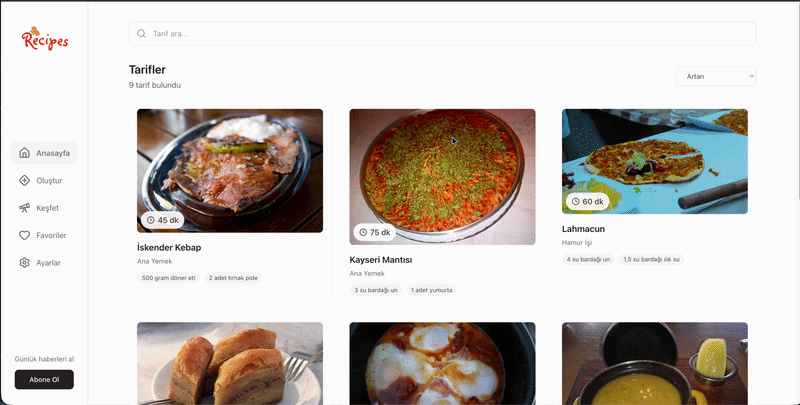

# 🍲 Recipes

Kullanıcıların tarif oluşturup keşfedebildiği, favorilere ekleyebildiği full-stack bir tarif paylaşım platformu. React (Vite) tabanlı frontend ve Express tabanlı REST API ile geliştirilmiştir.

## 🖼️ Ekran Görüntüleri



## ✨ Özellikler

- 🔍 Tarif arama ve listeleme
- 📋 Kategori, ülke, hazırlanma süresi gibi filtrelenebilir bilgiler
- ➕ Yeni tarif oluşturma (malzemeler, adımlar, görsel URL)
- ✏️ Tarif düzenleme ve silme
- ❤️ Favorilere ekleme
- 🧭 Keşfet sayfası ile yeni tarifleri gezinme
- ⚙️ Kullanıcı ayarları
- 📬 Bültene abone olma (günlük haberler)

## 🛠️ Kullanılan Teknolojiler

**Frontend (`client`)**
- React 19
- Vite
- Tailwind CSS 4
- React Router
- TanStack React Query
- Axios
- React Select
- React Toastify
- Lucide React (ikonlar)

**Backend (`api`)**
- Node.js
- Express 5
- CORS
- Nodemon (geliştirme ortamı)

## 📂 Proje Yapısı

```
recipes/
├── client/          # React + Vite frontend
│   ├── src/
│   ├── package.json
│   └── ...
├── api/             # Express REST API
│   ├── server.js
│   ├── package.json
│   └── ...
└── README.md
```

## 🚀 Kurulum

Depoyu klonlayın:

```bash
git clone https://github.com/kullanici-adiniz/recipes.git
cd recipes
```

### Backend (API)

```bash
cd api
npm install
npm run dev
```

### Frontend (Client)

```bash
cd client
npm install
npm run dev
```

Uygulama varsayılan olarak Vite'ın dev sunucusu üzerinden (genellikle `http://localhost:5173`) çalışacaktır.


## 📄 Lisans

Bu proje kişisel/eğitim amaçlıdır. Lisans bilgisini ihtiyacınıza göre güncelleyebilirsiniz.